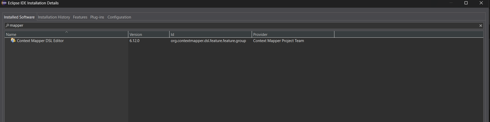
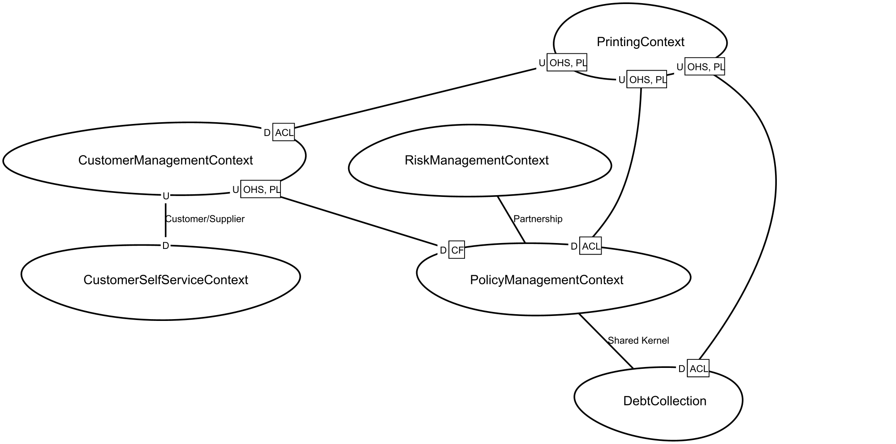
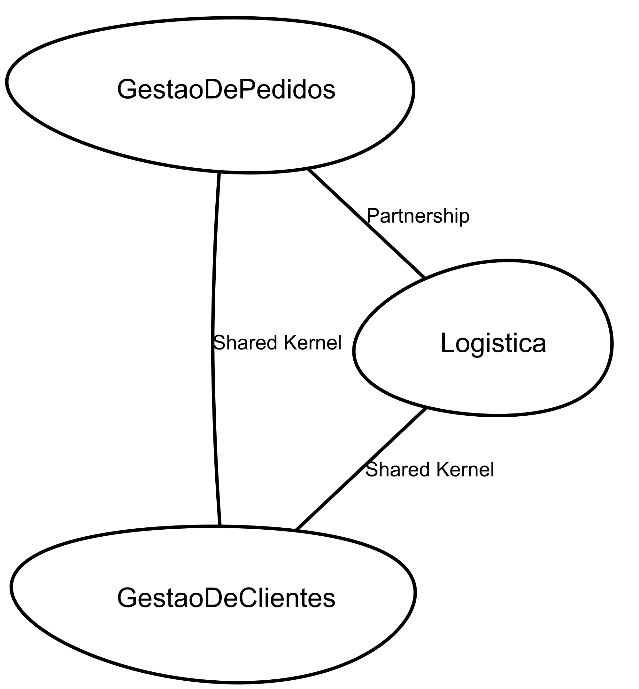
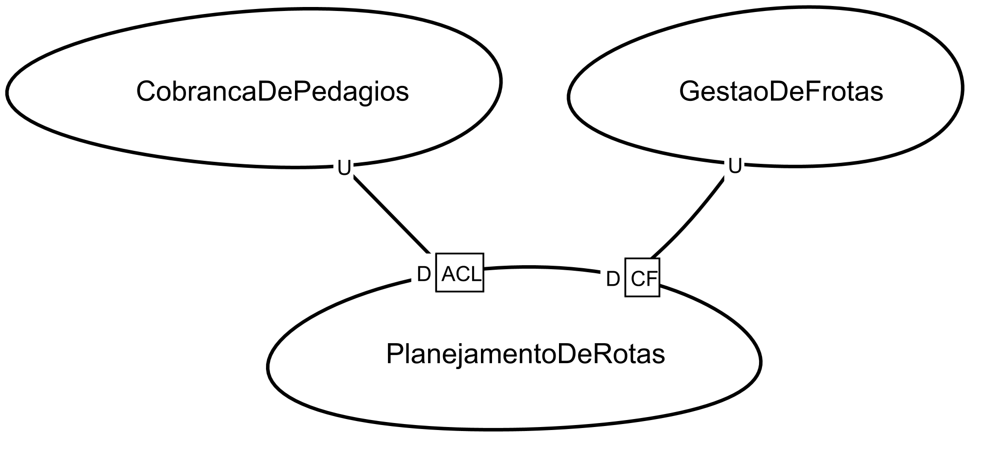
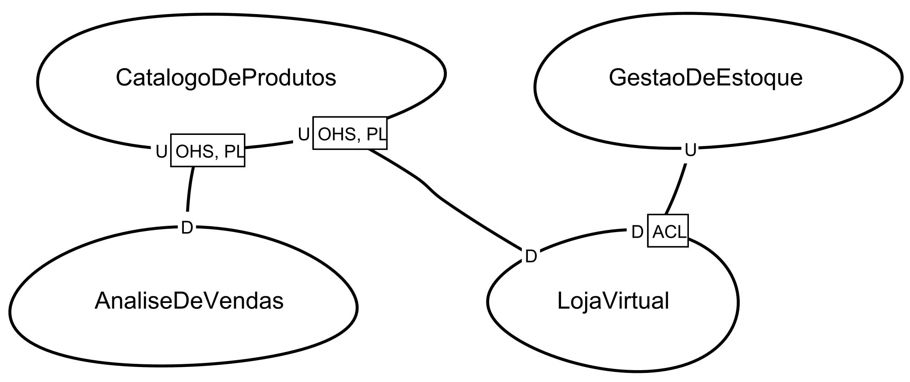
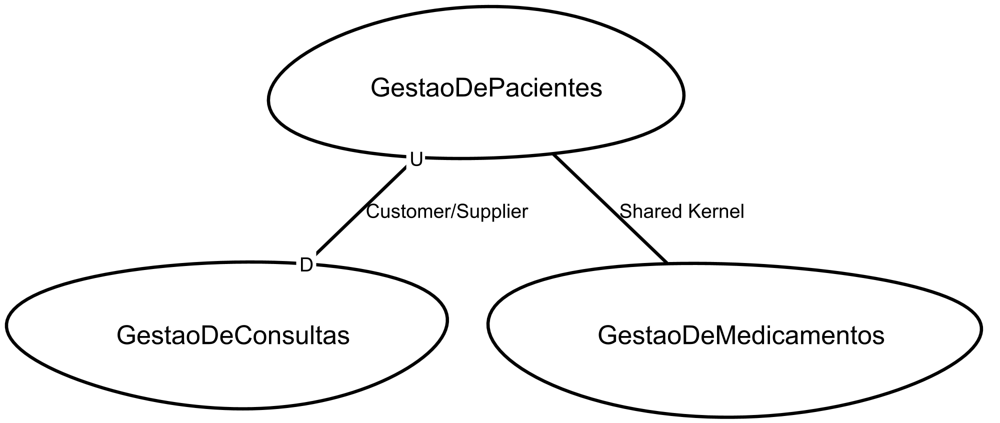

# Modelagem — Resolução da Atividade Aula 5.1

**Aluno(a):** Geovanna
**Matrícula:** 32421BSI006
**Curso:** Bacharelado em Sistemas de Informação (BSI) — UFU
**Data de entrega:** [25/11/2026]
**Professor(a):** Victor Sobreira

---

## Sumário

- [Atividade:: ContextMapper](#questão-1---atividade-contextmapper)
- [Atividade:: Parceria e Núcleo Compartilhado (1)](#questão-2---atividade-parceria-e-núcleo-compartilhado-1)
- [Atividade:: Parceria e Núcleo Compartilhado (2)](#questão-3---atividade-parceria-e-núcleo-compartilhado-2)
- [Atividade:: Parceria e Núcleo Compartilhado (3)](#questão-4---atividade-parceria-e-núcleo-compartilhado-3)
- [Atividade:: CF e ACL (1)](#questão-5---atividade-cf-e-acl-1)
- [Atividade:: CF e ACL (2)](#questão-6---atividade-cf-e-acl-2)
- [Atividade:: ACL, OHS e PL (1)](#questão-7---atividade-acl-ohs-e-pl-1)
- [Atividade:: ACL, OHS e PL (2)](#questão-8---atividade-acl-ohs-e-pl-2)
- [Atividade:: C/S, SW e SK (1)](#questão-9---atividade-cs-sw-e-sk-1)
- [Atividade:: C/S, SW e SK (2)](#questão-10---atividade-cs-sw-e-sk-2)

---

## Questão 1 - Atividade:: ContextMapper

**Enunciado:**
> 1. Acesse o site da ferramenta ContextMapper, revise e execute as instruções para instalação do plugin para o Eclipse desta ferramenta.

**Resolução:**

No site contextmapper.org, na parte de Eclipse, a instalação é feita pelo próprio Eclipse. Os passos foram:

1. Abrir o Eclipse e ir em **Help > Eclipse Marketplace**.
2. Buscar por "Context Mapper" e clicar em **Install**. Outra opção é ir em **Help > Install New Software** e colar o endereço `https://contextmapper.org/eclipse-update-site/`.
3. Aceitar a licença e reiniciar o Eclipse.
4. Instalar o Graphviz e colocar a pasta `bin` dele no PATH do Windows, porque o plugin usa ele para desenhar o mapa. Dá para conferir com `dot -V` no terminal.



*Figura 1 — Tela do Eclipse mostrando o plugin Context Mapper instalado (Help > About Eclipse > Installation Details)*

---

**Enunciado:**
> 2. Execute testes com os exemplos de modelos, carregando os modelos no Eclipse e visualizando os mapas de contextos feitos com a ferramenta. Os exemplos estão em um repositório do GitHub.

**Resolução:**

Os exemplos foram baixados do repositório `ContextMapper/context-mapper-examples` e estão na pasta `context-mapper-examples-master`. No Eclipse, criei um projeto e copiei para ele o modelo do exemplo, que fica em src/main/cml.

Para testar, abri o `Insurance-Example-Stage-3.cml` (pasta `insurance-example`). Nele aparecem quase todos os padrões da aula: Cliente-Fornecedor (`[D,C]<-[U,S]`), ACL, OHS e PL, Parceria (`[P]<->[P]`), Conformista e Núcleo Compartilhado (`[SK]<->[SK]`). Com o botão direito no editor, em **Context Mapper > Generate Graphical Context Map**, o plugin gera a imagem do mapa na pasta `src-gen`.



*Figura 2 — Mapa de contextos gerado pelo ContextMapper a partir do Insurance-Example-Stage-3.cml*

---

**Enunciado:**
> 3. Para as questões a seguir, quando for solicitado a criação de modelos, utilize o ContextMapper para gerar os diagramas.

**Resolução:**

Os modelos das questões 4, 6, 8 e 10 estão na pasta `modelos/` (`questao4.cml`, `questao6.cml`, `questao8.cml` e `questao10.cml`). As figuras dessas questões foram geradas a partir desses arquivos.

---

## Questão 2 - Atividade:: Parceria e Núcleo Compartilhado (1)

**Enunciado:**
> 1. Qual é a principal diferença entre os padrões Parceria e Núcleo Compartilhado?

**Resolução:**

Na Parceria os contextos só colaboram e se coordenam, mas cada um mantém o seu próprio modelo. No Núcleo Compartilhado eles realmente dividem uma parte do modelo, do código ou dos dados, que é mantida como uma unidade só pelas duas equipes.

---

**Enunciado:**
> 2. Em que situações você acha que seria benéfico usar ambos os padrões?

**Resolução:**

Quando dois contextos dependem um do outro para terminar um processo e ainda usam o mesmo conceito com o mesmo significado. Por exemplo, Pedidos e Logística precisam se coordenar para a entrega acontecer e os dois usam os mesmos dados de entrega do cliente. A Parceria cuida da coordenação e o Núcleo Compartilhado evita que esses dados fiquem duplicados.

---

**Enunciado:**
> 3. Quais são os benefícios e os riscos de combinar esses dois padrões?

**Resolução:**

Benefícios: as equipes já conversam bastante por causa da Parceria, então fica mais fácil combinar mudanças no núcleo. Os dados compartilhados ficam consistentes e sem duplicação.

Riscos: aumenta o acoplamento entre os contextos, porque além de depender um do outro eles ainda dividem código. Qualquer mudança no núcleo precisa ser combinada entre as equipes, o que deixa a evolução mais lenta. Se o núcleo crescer demais, os contextos perdem autonomia e o sistema pode virar uma Grande Bola de Lama.

---

**Enunciado:**
> 4. Pense em exemplos de projetos que conheça, indicando contextos que poderiam utilizar cada padrão.

**Resolução:**

**Aplicativo de entrega de comida**
Pedido e Entrega poderiam ser uma Parceria. O pedido só é concluído quando a entrega termina, e a entrega só existe se tiver um pedido.

**Aplicativo de transporte (tipo Uber)**
Corrida e Pagamento poderiam ser uma Parceria, porque a corrida só fecha quando o pagamento é aprovado e o pagamento depende dos dados da corrida.

**Sistema acadêmico da universidade**
Matrículas e Biblioteca poderiam usar um Núcleo Compartilhado com o modelo de "Aluno" (matrícula, nome, curso e situação). Os dois precisam saber se o aluno está ativo e usam esse conceito com o mesmo significado.

---

## Questão 3 - Atividade:: Parceria e Núcleo Compartilhado (2)

**Enunciado:**
> 1. Considere os contextos:
> 1. Gestão de Pedidos: gerencia pedidos de clientes, incluindo itens, quantidades, preços e status de entrega.
> 2. Logística: gerencia a entrega de pedidos, incluindo rotas, veículos e prazos de entrega.
> 3. Gestão de Clientes: gerencia informações sobre clientes, como nome, endereço, contato e histórico de compras.
>
> 2. Analise como os contextos de Gestão de Pedidos e Logística poderiam se beneficiar de uma Parceria.

**Resolução:**

Os dois dependem um do outro. A Logística só consegue planejar a rota e o prazo quando recebe o pedido confirmado, e a Gestão de Pedidos só consegue atualizar o status de entrega com as informações que vêm da Logística.

Fluxo da Parceria:
- Passo 1: Gestão de Pedidos confirma um pedido e avisa a Logística.
- Passo 2: Logística define a rota, o veículo e o prazo de entrega e devolve o prazo para Pedidos.
- Passo 3: Durante a entrega, Logística informa as mudanças (saiu para entrega, entregue) e Pedidos atualiza o status para o cliente.

Com a Parceria as duas equipes planejam juntas as mudanças que afetam a entrega, como um novo tipo de entrega expressa. Assim um lado não quebra o outro e o objetivo comum, que é o pedido chegar ao cliente no prazo, fica alinhado.

---

## Questão 4 - Atividade:: Parceria e Núcleo Compartilhado (3)

**Enunciado:**
> 3. Identifique um subconjunto comum de modelos, código ou dados que poderia ser compartilhado entre os contextos e indique um plano para implementar um Núcleo Compartilhado.

**Resolução:**

O subconjunto comum são os **Dados de Entrega**: identificação do cliente, nome, endereço de entrega e contato. Gestão de Clientes cadastra esses dados, Gestão de Pedidos usa para registrar para onde vai o pedido e Logística usa para montar a rota. Itens, preços, rotas, veículos e histórico de compras ficam de fora, cada um no seu contexto.

Plano para o Núcleo Compartilhado:
- Passo 1: As três equipes definem juntas o modelo "Dados de Entrega" (id do cliente, nome, endereço, contato).
- Passo 2: Esse modelo vira um módulo ou biblioteca separada, com as regras básicas, como a validação do endereço e do CEP.
- Passo 3: Os três contextos passam a usar a mesma biblioteca em vez de cada um ter sua cópia.
- Passo 4: Qualquer mudança no núcleo (ex.: novo campo "ponto de referência") é combinada entre as equipes antes de ser feita.
- Passo 5: Quando o cliente muda o endereço em Gestão de Clientes, Pedidos e Logística já enxergam o endereço novo.

---

**Enunciado:**
> 4. Documente o plano em um diagrama, complementado por texto, destacando os pontos-chave da aplicação dos padrões.

**Resolução:**



*Figura 3 — Mapa de contextos gerado a partir de modelos/questao4.cml: Gestão de Pedidos e Logística ligados por Parceria (P), e os três contextos ligados a Gestão de Clientes por Núcleo Compartilhado (SK) com o modelo Dados de Entrega*

O modelo está em `modelos/questao4.cml`. Pontos principais:

**Parceria (P) entre Gestão de Pedidos e Logística:** relação simétrica e de dependência mútua. As equipes se coordenam para o pedido ser entregue.

**Núcleo Compartilhado (SK) com Gestão de Clientes:** só o modelo Dados de Entrega é compartilhado. O resto de cada contexto continua independente, então o acoplamento fica limitado a esse módulo.

**Cuidado com o núcleo:** como o SK traz acoplamento, ele precisa continuar pequeno. Mudanças nele só entram depois de combinadas entre as três equipes.

---

## Questão 5 - Atividade:: CF e ACL (1)

**Enunciado:**
> 1. Qual é a principal diferença entre os padrões CF e ACL?

**Resolução:**

No Conformista o contexto downstream aceita o modelo do upstream do jeito que ele é, sem tradução. Na ACL o downstream cria uma camada que traduz o modelo externo para a sua própria linguagem ubíqua, então ele não fica preso aos termos do outro contexto.

---

**Enunciado:**
> 2. Em que situações seria benéfico usar cada um desses padrões?

**Resolução:**

**Conformista (CF):** quando o modelo do contexto dominante é bom o bastante para o downstream e não dá para mudar ele, como uma API externa de mapas. Também quando a integração precisa ser simples e rápida.

**Camada Anti-Corrupção (ACL):** quando o outro contexto é um sistema legado ou de terceiros com um modelo confuso, ultrapassado ou com termos diferentes dos nossos, como no exemplo do RH com a folha de pagamento legada.

---

**Enunciado:**
> 3. Quais são os benefícios e os riscos de usá-los?

**Resolução:**

**Conformista (CF):**
Benefícios: integração simples, sem trabalho de tradução e sem modelos duplicados.
Riscos: o downstream fica dependente do modelo do upstream. Se o upstream mudar, o downstream é afetado direto, e termos estranhos podem entrar no seu modelo.

**Camada Anti-Corrupção (ACL):**
Benefícios: protege o modelo interno e mantém a linguagem ubíqua do contexto. Mudanças no sistema externo ficam concentradas na camada.
Riscos: dá mais trabalho para construir e manter, porque a tradução precisa ser atualizada sempre que o sistema externo muda. Também pode deixar as chamadas mais lentas.

---

## Questão 6 - Atividade:: CF e ACL (2)

**Enunciado:**
> 1. Considere os contextos:
> - Gestão de Frotas: gerencia veículos, motoristas e manutenção.
> - Planejamento de Rotas: planeja as rotas de entrega com base na localização dos clientes e na disponibilidade dos veículos.
> - Cobrança de Pedágios: sistema legado utilizado para cálculos e informações relativas a pedágios.
>
> 2. Como os contextos de Gestão de Frotas e Planejamento de Rotas poderiam se beneficiar do padrão Conformista?

**Resolução:**

Gestão de Frotas é o contexto upstream, porque é ele que sabe quais veículos e motoristas existem e quais estão disponíveis ou em manutenção. Planejamento de Rotas fica como Conformista e usa o modelo de "Veículo" da Frota como ele é (placa, capacidade, status de disponibilidade), sem criar um modelo próprio.

O benefício é que Rotas não precisa duplicar e sincronizar os dados dos veículos. Quando um veículo entra em manutenção, Rotas já vê ele como indisponível. Para Frotas também é mais simples, porque não precisa adaptar o seu modelo para Rotas.

---

**Enunciado:**
> 3. Como o contexto de Planejamento de Rotas poderia se proteger do sistema legado de cobrança de pedágios usando uma ACL?

**Resolução:**

Planejamento de Rotas não chama o sistema legado direto. Ele fala com uma ACL, que faz a tradução nos dois sentidos.

Fluxo:
- Passo 1: Rotas pede para a ACL o custo de pedágio de uma rota, usando os termos dele (trecho, categoria do veículo).
- Passo 2: A ACL converte esses dados para o formato que o legado entende (códigos de praça, código de categoria).
- Passo 3: A ACL consulta o sistema legado e recebe o valor no formato antigo.
- Passo 4: A ACL converte a resposta para "Custo de Pedágio da Rota" e devolve para Rotas.

Assim os códigos e termos do legado não entram no modelo de Rotas. Se o sistema de pedágios for trocado um dia, só a ACL precisa mudar.

---

**Enunciado:**
> 4. Documente o plano em um diagrama, complementado por texto, destacando os pontos-chave da aplicação dos padrões.

**Resolução:**



*Figura 4 — Mapa de contextos gerado a partir de modelos/questao6.cml: Gestão de Frotas (U) para Planejamento de Rotas (D, CF), e Cobrança de Pedágios (U) para Planejamento de Rotas (D, ACL)*

O modelo está em `modelos/questao6.cml`. Pontos principais:

**Gestão de Frotas → Planejamento de Rotas (U → D, CF):** relação assimétrica. Rotas segue o modelo de Veículo da Frota sem tradução.

**Cobrança de Pedágios → Planejamento de Rotas (U → D, ACL):** o legado é o upstream, mas Rotas se isola dele com a ACL, que traduz os dados de pedágio para a linguagem de Rotas.

**Por que padrões diferentes:** o modelo da Frota é claro e faz sentido para Rotas, então vale se conformar. O modelo do legado de pedágios é antigo e diferente, então vale proteger o contexto.

---

## Questão 7 - Atividade:: ACL, OHS e PL (1)

**Enunciado:**
> 1. Qual é a principal diferença entre os padrões PL e OHS?

**Resolução:**

O OHS é o serviço em si, uma interface pública e estável (como uma API) que o contexto anfitrião oferece para vários consumidores. A PL é a linguagem usada nessa comunicação, um formato comum e documentado, como um esquema JSON. Ou seja, o OHS define por onde os contextos se comunicam e a PL define em qual formato.

---

**Enunciado:**
> 2. A ACL pode ser usada em conjunto com esses padrões? Explique.

**Resolução:**

Sim. O OHS e a PL ficam do lado upstream e a ACL fica do lado downstream. Mesmo que o upstream ofereça uma API estável com uma linguagem publicada, o consumidor pode usar uma ACL para traduzir essa linguagem para os seus próprios termos. No exemplo de seguradora do ContextMapper isso aparece como `[D,ACL]<-[U,OHS,PL]`.

---

**Enunciado:**
> 3. Quais são os benefícios e os riscos de combinar esses padrões?

**Resolução:**

Benefícios: o upstream mantém uma interface só para todos os consumidores, sem adaptações para cada um. Os consumidores ficam desacoplados e, com a ACL, a linguagem ubíqua deles não é afetada pela do anfitrião.

Riscos: mais camadas para construir e manter. Se a PL mudar sem compatibilidade com versões anteriores, todos os consumidores precisam ajustar as suas ACLs. Quando a PL já é parecida com o modelo do consumidor, a ACL pode ser um trabalho a mais sem necessidade.

---

## Questão 8 - Atividade:: ACL, OHS e PL (2)

**Enunciado:**
> 1. Considere os contextos:
> - Catálogo de Produtos: gerencia informações sobre produtos, como nome, descrição, categorias e preço.
> - Loja Virtual: exibe informações detalhadas dos produtos para os clientes e processa pedidos.
> - Análise de Vendas: analisa dados de vendas, como tendências de consumo e desempenho de produtos.
> - Gestão de Estoque: sistema legado de gestão de estoque, com modelo de dados ultrapassado e complexo, porém funcional.
>
> 2. Como Catálogo de Produtos poderia expor uma linguagem e uma interface de consulta para Loja e Análise de Vendas?

**Resolução:**

O Catálogo de Produtos vira o anfitrião (OHS) e expõe uma API pública de consulta, por exemplo:
- `GET /produtos`: lista os produtos com nome, categoria e preço.
- `GET /produtos/{id}`: detalhes completos de um produto.
- `GET /categorias/{id}/produtos`: produtos de uma categoria.

As respostas seguem uma Linguagem Publicada (PL), que é um esquema JSON de "Produto" documentado:

```json
{
  "id": "P-100",
  "nome": "Notebook XYZ",
  "descricao": "Notebook 15 polegadas",
  "categoria": "Informática",
  "preco": 2500.00
}
```

A Loja Virtual usa a API para montar a página dos produtos e a Análise de Vendas usa a mesma API para saber a categoria e o preço dos produtos vendidos. Nenhum dos dois precisa conhecer o modelo interno do Catálogo, e o Catálogo pode evoluir desde que mantenha a API e o esquema compatíveis.

---

**Enunciado:**
> 3. Como a Loja poderia se proteger do sistema legado de gestão de estoque?

**Resolução:**

Com uma ACL entre a Loja e o legado de estoque. A Loja só pergunta "este produto está disponível e em qual quantidade?" usando o id do produto dela. A ACL converte esse id para o código que o legado usa, faz a consulta e traduz a resposta (códigos de situação, saldo por depósito) para "Disponível" ou "Indisponível" e a quantidade. Assim o modelo antigo do estoque não entra na Loja, e se o legado for substituído só a ACL muda.

---

**Enunciado:**
> 4. Documente o plano em um diagrama, complementado por texto, destacando os pontos-chave da aplicação dos padrões.

**Resolução:**



*Figura 5 — Mapa de contextos gerado a partir de modelos/questao8.cml: Catálogo de Produtos (U, OHS, PL) para Loja Virtual e Análise de Vendas (D), e Gestão de Estoque (U) para Loja Virtual (D, ACL)*

O modelo está em `modelos/questao8.cml`. Pontos principais:

**Catálogo de Produtos (U, OHS, PL):** uma API só, estável, usada pelos dois consumidores. A PL é o esquema JSON de Produto documentado.

**Loja Virtual e Análise de Vendas (D):** consomem a API sem conhecer o modelo interno do Catálogo.

**Gestão de Estoque → Loja Virtual (U → D, ACL):** a Loja depende do estoque legado, mas a ACL traduz os dados para a linguagem da Loja e protege o modelo dela.

---

## Questão 9 - Atividade:: C/S, SW e SK (1)

**Enunciado:**
> 1. Qual é a principal diferença entre os padrões C/S, SW e SK?

**Resolução:**

No Cliente-Fornecedor (C/S) existe uma dependência de um lado só: o cliente depende do fornecedor, que oferece uma interface clara. No Núcleo Compartilhado (SK) os contextos dividem uma parte do modelo, então a relação é simétrica e mais acoplada. Em Caminhos Separados (SW) não existe integração nenhuma, cada contexto evolui sozinho.

---

**Enunciado:**
> 2. Em que situações é benéfico usar cada padrão?

**Resolução:**

**Cliente-Fornecedor (C/S):** quando um contexto precisa de dados ou serviços de outro, mas o outro não precisa dele. Ex.: Pedidos consultando preço e disponibilidade no Catálogo.

**Núcleo Compartilhado (SK):** quando dois contextos usam um mesmo conceito com o mesmo significado e duplicar esse modelo daria inconsistência. Ex.: o modelo de Funcionário entre RH e Controle de Acesso.

**Caminhos Separados (SW):** quando os domínios são diferentes e integrar custaria mais do que traria de valor. Ex.: RH e Gestão de Projetos.

---

**Enunciado:**
> 3. É possível combiná-los em um mesmo mapa de contexto? Explique.

**Resolução:**

Sim. Cada padrão descreve a relação entre um par de contextos, então um mesmo mapa pode ter pares com C/S, pares com SK e pares que seguem Caminhos Separados. O que não faz sentido é usar SW e outro padrão no mesmo par, porque SW quer dizer que não há integração entre eles. A questão 10 mostra os três juntos no mesmo mapa.

---

## Questão 10 - Atividade:: C/S, SW e SK (2)

**Enunciado:**
> 1. Considere os contextos:
> - Gestão de Pacientes: gerencia informações sobre pacientes, como nome, endereço, contato, histórico médico e agendamento de consultas.
> - Gestão de Consultas: gerencia consultas médicas, incluindo agendamento, cancelamento e registro de diagnósticos.
> - Gestão de Medicamentos: gerencia o estoque de medicamentos, incluindo reposição, distribuição e controle de validade.
>
> 2. Identifique um subconjunto comum de modelos, código ou dados que poderia ser compartilhado entre Gestão de Pacientes e Gestão de Medicamentos, e desenvolva um plano para implementar um SK.

**Resolução:**

O subconjunto comum é o **Paciente Básico**: id do paciente, nome e alergias a medicamentos. Gestão de Pacientes mantém esses dados no histórico médico e Gestão de Medicamentos precisa deles na hora de distribuir um medicamento, para saber para quem vai e se o paciente tem alergia. Endereço, contato e histórico completo ficam só em Pacientes, e estoque, reposição e validade ficam só em Medicamentos.

Plano para o SK:
- Passo 1: As equipes de Pacientes e Medicamentos definem juntas o modelo "Paciente Básico" (id, nome, lista de alergias).
- Passo 2: O modelo vira um módulo compartilhado com as regras básicas, como verificar se o paciente tem alergia a um princípio ativo.
- Passo 3: Os dois contextos passam a usar esse módulo em vez de manter cópias diferentes.
- Passo 4: Mudanças no módulo (ex.: novo campo "restrição por idade") são combinadas entre as duas equipes.
- Passo 5: Quando uma alergia nova é registrada em Pacientes, Medicamentos já leva ela em conta na distribuição.

---

**Enunciado:**
> 3. Há contextos que não deveriam se relacionar, caracterizando um SK?

**Resolução:**

Sim. Gestão de Consultas e Gestão de Medicamentos não precisam se relacionar. Consultas cuida de agendamento e diagnóstico, e Medicamentos cuida de estoque e validade, então eles podem seguir Caminhos Separados (SW), sem modelo ou dados compartilhados.

Gestão de Consultas também não deveria entrar no Núcleo Compartilhado. Ela só precisa consultar os dados do paciente, então a relação com Gestão de Pacientes fica melhor como Cliente-Fornecedor (Pacientes é o fornecedor e Consultas é o cliente). Colocar Consultas no SK só aumentaria o acoplamento.

---

**Enunciado:**
> 4. Documente o plano em um diagrama, complementado por texto, destacando os pontos-chave da aplicação dos padrões.

**Resolução:**



*Figura 6 — Mapa de contextos gerado a partir de modelos/questao10.cml: Gestão de Pacientes e Gestão de Medicamentos com Núcleo Compartilhado (SK), Gestão de Pacientes (U, S) para Gestão de Consultas (D, C) e nenhuma ligação entre Consultas e Medicamentos (SW)*

O modelo está em `modelos/questao10.cml`. Pontos principais:

**Gestão de Pacientes ↔ Gestão de Medicamentos (SK):** só o modelo Paciente Básico é compartilhado e as mudanças nele são combinadas entre as duas equipes.

**Gestão de Pacientes → Gestão de Consultas (C/S):** Pacientes fornece os dados por uma interface clara e Consultas só consome.

**Gestão de Consultas e Gestão de Medicamentos (SW):** não aparecem ligados no mapa porque seguem Caminhos Separados. O ContextMapper não tem um símbolo para SW, então a ausência de relação é que representa o padrão.

---

## Referências

- Slides da aula 5.1 — Design Estratégico e Mapeamento de Contextos, Prof. Victor Sobreira
- Context Mapper: https://contextmapper.org/docs/eclipse/
- Exemplos do Context Mapper: https://github.com/ContextMapper/context-mapper-examples
